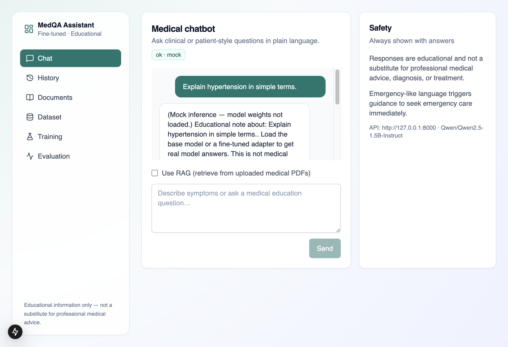
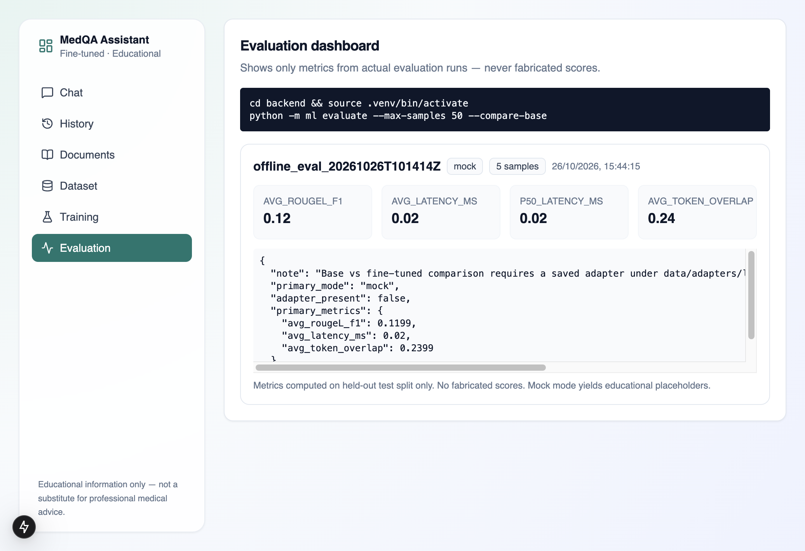
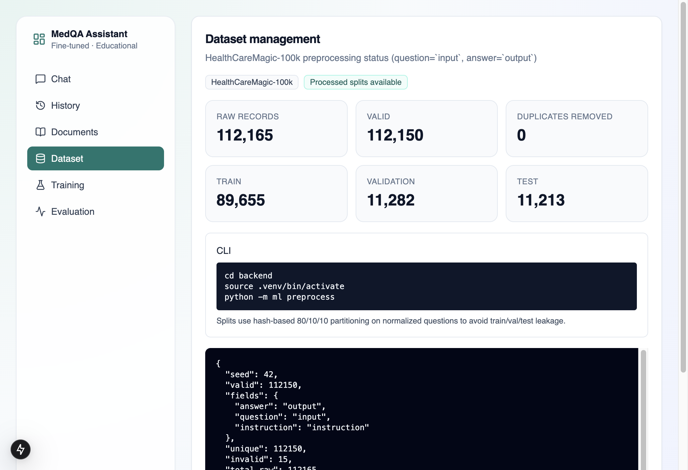
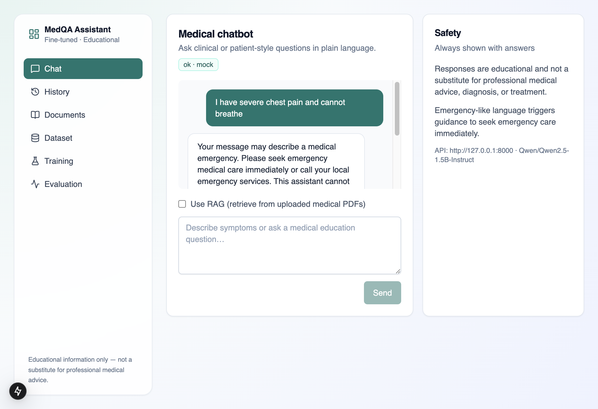
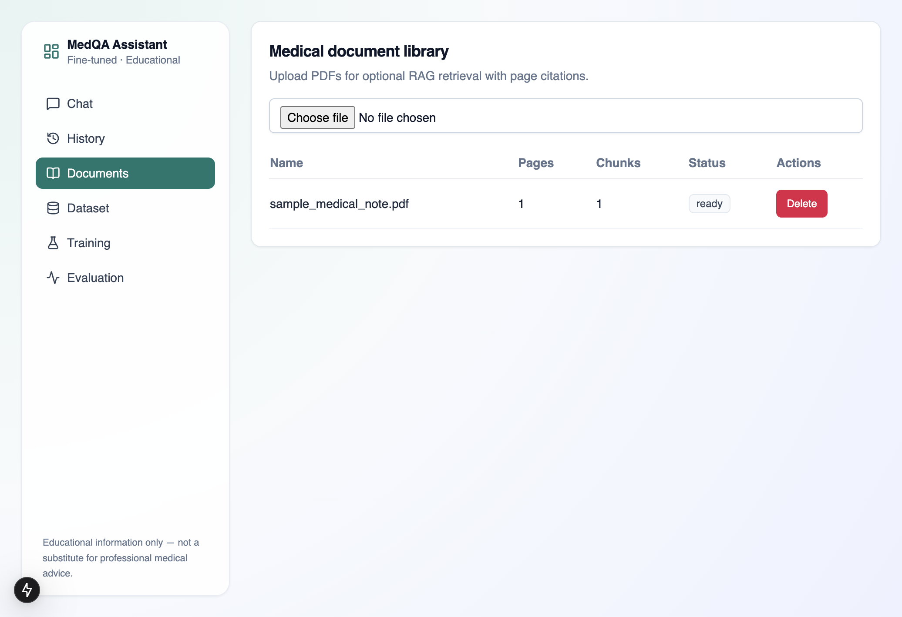
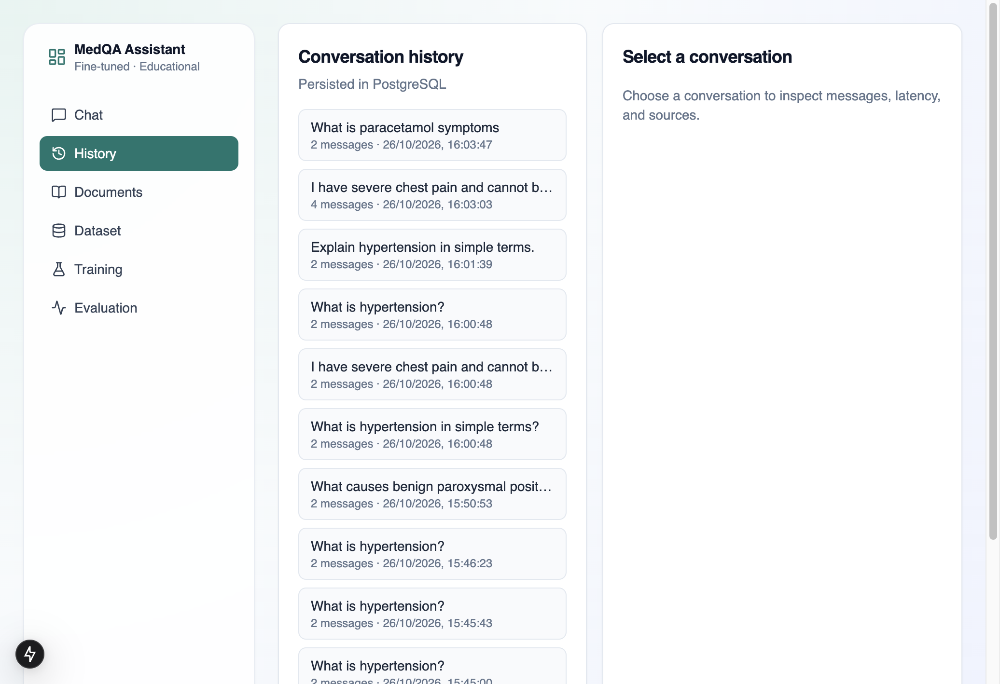
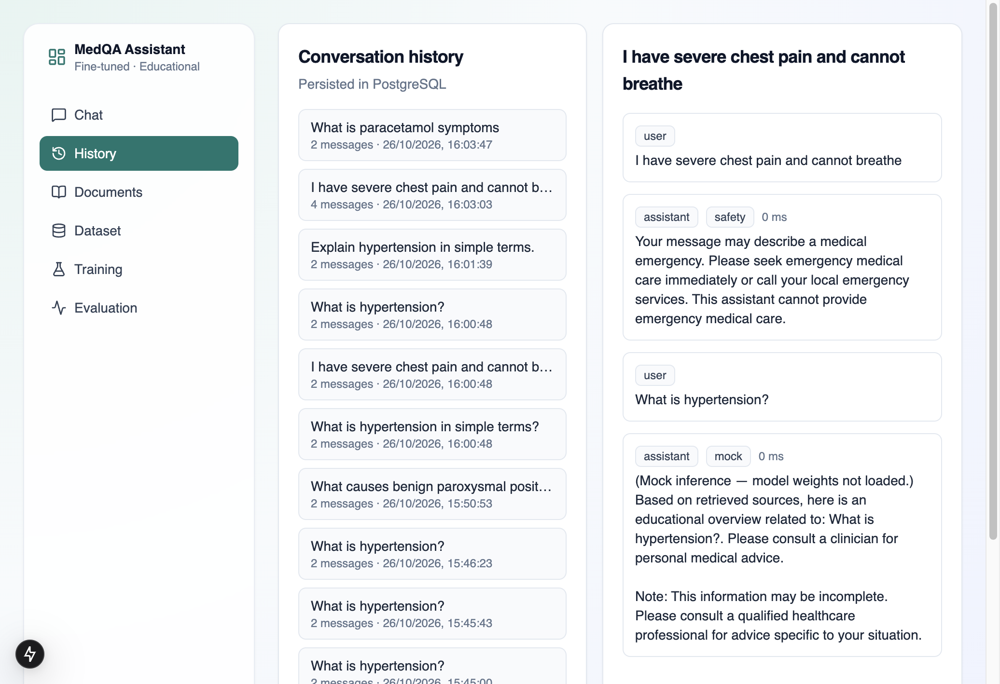

# Project Report: Fine-Tuned Medical Q&A Assistant

**Title:** Fine-Tuned Medical Q&A Assistant  
**Dataset:** HealthCareMagic-100k (112,165 Q&A pairs)  
**Frontend:** Next.js · TypeScript · Tailwind CSS · shadcn-style UI  
**Backend:** Python · FastAPI · PostgreSQL · pgvector  
**AI/ML:** PyTorch · Hugging Face Transformers · TRL · PEFT (LoRA/QLoRA)  
**Deployment:** Docker Compose  

> **Disclaimer:** This system provides educational information only. It is not a substitute for professional medical advice, diagnosis, or treatment.

---

## 1. Problem Statement

Medical information is scattered across papers, studies, textbooks, and patient forums. General-purpose language models often:

- Lack domain adaptation for clinical / patient Q&A style  
- Hallucinate facts or give unsafe advice without safeguards  
- Provide no pathway to fine-tune on large medical Q&A corpora  
- Omit citations when grounding answers in uploaded literature  

**Problem:** Build an intelligent **Fine-Tuned Medical Q&A Assistant** that:

1. Learns from a large-scale medical Q&A dataset (HealthCareMagic-100k)  
2. Answers clinical and patient-style questions in simple language  
3. Optionally retrieves evidence from uploaded medical PDFs (RAG)  
4. Applies medical safety checks, uncertainty handling, and clear disclaimers  
5. Exposes training, dataset, and evaluation dashboards with **real** metrics only  

This matches the course problem statement deliverables: preprocessing + fine-tuning code, a fine-tuned LLM pathway, a project report, and screenshots of outputs/evaluation.

---

## 2. Objectives

1. Inspect and preprocess HealthCareMagic-100k (validate, dedupe, leak-free splits)  
2. Implement configurable LoRA/QLoRA fine-tuning (Qwen2.5-1.5B-Instruct base)  
3. Serve chat via FastAPI with safety, history, and optional RAG  
4. Provide a professional multi-page dashboard  
5. Evaluate on a held-out test set and display real metrics  
6. Package with Docker Compose, tests, and documentation  

---

## 3. Methodology

### 3.1 Dataset inspection and preprocessing

The file `HealthCareMagic-100k.json` is a **ZIP archive** containing:

| Archive member | Role |
|----------------|------|
| `HealthCareMagic-100k.json` | Primary training corpus |
| `iCliniq.json` | Secondary (not used by default) |

**Record schema (uniform):**

| Field | Mapped role |
|-------|-------------|
| `instruction` | System / task instruction |
| `input` | Patient question |
| `output` | Doctor answer |

**Pipeline (`python -m ml preprocess`):**

1. Detect ZIP vs JSON; extract HealthCareMagic JSON  
2. Map fields → `{instruction, question, answer}`  
3. Drop invalid rows (empty / too short Q or A)  
4. Deduplicate on SHA-256 of normalized question+answer  
5. Split **80 / 10 / 10** using `sha256(seed|normalized_question) % 100`  
6. Write `data/processed/{train,val,test}.jsonl` + `stats.json`  
7. Verify **zero** question overlap across splits (no leakage)  

**Preprocessing results (actual run):**

| Metric | Value |
|--------|------:|
| Raw records | 112,165 |
| Valid | 112,150 |
| Invalid removed | 15 |
| Duplicates removed | 0 |
| Train | 89,655 |
| Validation | 11,282 |
| Test | 11,213 |
| Question overlap train∩val / train∩test / val∩test | 0 / 0 / 0 |
| Avg question length (chars) | 437.74 |
| Avg answer length (chars) | 649.23 |

### 3.2 System architecture

```text
Next.js Dashboard (Chat · History · Documents · Dataset · Training · Evaluation)
        │ HTTP + CORS
        ▼
FastAPI
  ├─ Safety checks (emergency / harmful)
  ├─ Optional RAG (pgvector cosine retrieval + citations)
  ├─ Inference (base HF model or LoRA adapter; mock mode when weights unloaded)
  └─ PostgreSQL + pgvector (conversations, chunks, training/eval runs)

Offline CLIs:
  ml preprocess → ml train (LoRA/QLoRA) → ml evaluate
```

### 3.3 Fine-tuning approach

| Item | Choice |
|------|--------|
| Base model | `Qwen/Qwen2.5-1.5B-Instruct` (Apache-2.0) |
| Method | PEFT LoRA; QLoRA 4-bit when `hardware_profile=cuda` + bitsandbytes |
| Trainer | TRL `SFTTrainer` |
| Config | `backend/configs/train.yaml` (samples, epochs, lr, LoRA r/α, device) |
| Default laptop run | Subset (`max_samples: 2000`) — full 112k intended for GPU boxes |
| Output | `data/adapters/latest/` + `training_metrics.json` |

Training is **never auto-started** from the UI or CI. Register configs in the Training page; run:

```bash
cd backend && source .venv/bin/activate
export PYTHONPATH=.
python -m ml train --config configs/train.yaml
```

### 3.4 Chat and safety

- Educational disclaimer on every response  
- Emergency keyword detection → urge emergency services (no diagnosis)  
- Harmful intent block  
- Uncertainty framing when answers are incomplete  
- Conversations persisted in PostgreSQL  

### 3.5 Optional RAG

Adapted from the local `ai-driven-healthcare-app` patterns (PyMuPDF → chunk → embed → retrieve), with **pgvector** instead of FAISS:

1. Upload PDF → extract pages → chunk (size 800, overlap 120)  
2. Embed with `BAAI/bge-small-en-v1.5` (or deterministic mock embeddings when `MOCK_INFERENCE=true`)  
3. Store vectors in PostgreSQL  
4. Retrieve top-k above similarity threshold; cite document + page  

### 3.6 Evaluation

Offline evaluation on the **held-out test** split only:

```bash
python -m ml evaluate --max-samples 50 --compare-base
```

Metrics recorded (never fabricated):

- Average / p50 latency (ms)  
- Token overlap (unigram precision vs reference)  
- ROUGE-L F1 (via `rouge-score` when available)  

Results persist to `data/processed/eval_results.json` and the Evaluation dashboard.

---

## 4. Results

### 4.1 Dataset

See §3.1. Leak-free 80/10/10 splits written under `data/processed/`.

### 4.2 Inference modes

| Mode | When | Behavior |
|------|------|----------|
| `mock` | `MOCK_INFERENCE=true` or weights unavailable | Educational placeholder; labeled in UI/API |
| `base` | HF base model loaded | Generation without adapter |
| `fine_tuned` | LoRA adapter present under `data/adapters/` | Generation with PEFT adapter |
| `safety` | Emergency / harmful flags | Fixed safety message, no model call |
| `rag_insufficient` | RAG on, no hits above threshold | Fixed insufficient-info message |

Current local demo health check: **`inference_mode: mock`**, database OK, RAG enabled.

### 4.3 Offline evaluation (actual run)

Run id: `offline_eval_20261026T101414Z` · mode: `mock` · sample size: **5**

| Metric | Value |
|--------|------:|
| avg_latency_ms | 0.02 |
| p50_latency_ms | 0.02 |
| avg_token_overlap | 0.2399 |
| avg_rougeL_f1 | 0.1199 |

**Interpretation:** These scores reflect **mock** placeholders vs gold answers, not a trained model. After fine-tuning with `MOCK_INFERENCE=false`, re-run evaluation to obtain real base vs adapter comparisons. No scores were invented for the dashboard.

### 4.4 Functional demonstrations

| Scenario | Result |
|----------|--------|
| Normal Q&A | Answer + disclaimer + latency + model mode |
| Emergency (“chest pain… cannot breathe”) | Safety block; emergency guidance |
| RAG on uploaded PDF | Answer with document/page citation when retrieval succeeds |
| Dataset page | Shows preprocess counts from `stats.json` / DB |
| Evaluation page | Shows only stored eval runs |

Sample JSON outputs are stored under [`deliverables/samples/`](samples/).  
Screenshots are stored under [`deliverables/screenshots/`](screenshots/).

### 4.6 Screenshot gallery

| Screenshot | What it shows |
|------------|---------------|
|  | Model chat output + disclaimer |
|  | Offline evaluation metrics dashboard |
|  | Preprocess / split statistics |
|  | Emergency safety handling |
|  | Uploaded PDF indexed for RAG |
|  | Persisted conversation history |
|  | Message-level modes, latency, answers |

Full captions: [`screenshots/README.md`](screenshots/README.md).

### 4.5 Tests

| Suite | Result |
|-------|--------|
| Backend `pytest` | 11 passed |
| Frontend `npm test` | 2 passed |
| Frontend `npm run build` | Success |

---

## 5. Limitations

1. Full-corpus fine-tuning needs a suitable GPU; laptop defaults use a subset.  
2. Apple Silicon: prefer `hardware_profile: mps` and `use_qlora: false`.  
3. Mock inference is used when weights are not loaded — clearly labeled.  
4. Educational use only — not a clinical decision-support product.  
5. Base vs fine-tuned metric comparison requires a saved adapter and real inference.

---

## 6. How to reproduce

```bash
# Database
docker compose up -d db

# Backend
cd backend && python3 -m venv .venv && source .venv/bin/activate
pip install -r requirements.txt
cp .env.example .env   # MOCK_INFERENCE=true for demo
export PYTHONPATH=.
python -m ml preprocess
uvicorn app.main:app --host 127.0.0.1 --port 8000

# Frontend
cd frontend && cp .env.example .env.local && npm install && npm run dev
```

Optional training / evaluation (GPU recommended for training):

```bash
python -m ml train --config configs/train.yaml
python -m ml evaluate --max-samples 50 --compare-base
```

---

## 7. Deliverables checklist

| Deliverable | Location |
|-------------|----------|
| Preprocess + fine-tune Python code | `backend/ml/` |
| Fine-tuned LLM pathway (LoRA/QLoRA) | `backend/ml/train.py`, `configs/train.yaml` |
| Project report | `deliverables/01-project-report.md` (this file) |
| Screenshots of outputs & evaluation | `deliverables/screenshots/` |
| Sample API outputs | `deliverables/samples/` |
| README with setup commands | `README.md` |

---

## 8. Conclusion

The project delivers a complete stack for medical Q&A: rigorous HealthCareMagic preprocessing, a configurable LoRA/QLoRA fine-tuning pipeline, a safety-aware chatbot with optional RAG citations, and an evaluation dashboard bound to real runs. Mock-mode demos keep the application usable without GPU weight downloads; production-quality model metrics require running training and evaluation on appropriate hardware as documented above.
